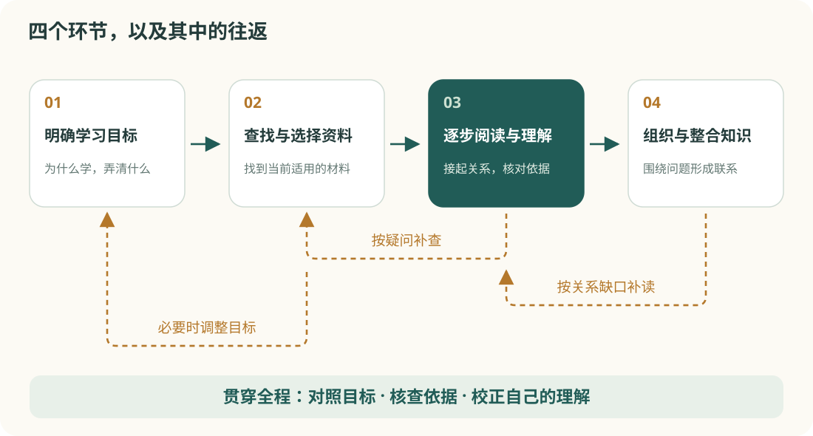

# 让知识更容易被读懂

<p class="lead">一份好的知识文档，应该让读者轻松看见结构、跟上解释，并在需要时回到某一节。排版的价值，是让内容自然地呈现出来。</p>

这是一份可以直接复用的知识文档模板。打开右上角的“阅读设置”，可以调整左右留白、背景颜色、字号、行距、缩进和字体。左右留白用一个滑杆连续控制，下面的圆点可以直接点击。左侧目录来自文章标题，会随着阅读位置更新；不需要目录时，可以收起它。

## 01　先让正文舒服，再安排装饰

### 一行文字应该有多长

当一行过长，视线从右侧返回下一行开头时，会更难定位；当一行过短，阅读又会频繁换行。这里默认使用 **18 像素**的中文正文字号。正文宽度完全由左右留白决定，没有额外的最大宽度限制：每侧留白 0% 就是满宽，每侧留白 40% 则形成一条较窄的正文。

宽屏上保留两侧空白，是为了稳定正文长度。目录拥有独立空间，正文不会因为标题很长而被挤窄。手机上则使用单栏，目录收进正文前方，点开即可跳转。

### 怎样建立清楚的层级

一级标题说明文章讨论的主题；二级标题划分章节；三级标题组织章节里的问题。它们通过**字号、字重和上下间距**区分，不必轮流使用不同的颜色。

普通段落保持朴素。需要强调的概念可以加粗，需要解释的术语可以使用行内代码，例如 `B-tree`。不要因为一个句子很重要，就把整段文字变成彩色。

<aside class="callout"><div class="callout-label">核心原则</div><p>统一的是展示规则，变化的是文章内容。模板不决定每一句话的样子，而是为不同类型的内容准备合适的位置。</p></aside>

## 02　让图、表和解释各司其职

### 图示：展示结构与联系

文字适合说明概念，图示适合展示概念之间的联系。下面沿用原文中的学习过程图，观察它怎样在正文宽度内显示；也可以点击图片，在独立窗口中查看细节。



*图 1　明确目标、选择资料、阅读理解和知识整合之间的关系。配图来自现有教材。*

图片不强行裁剪，也不把小图拉伸到整栏。图注与正文分开，读者能判断哪些内容属于图片说明。所有图片都会内嵌到最终 HTML，发送给手机时不需要附带图片文件夹。

### 表格：让并列信息更容易比较

| 内容类型 | 适合怎样呈现 | 应当避免 |
| --- | --- | --- |
| 连续解释 | 段落，必要时加少量粗体 | 每段都包进卡片 |
| 条件、步骤、要点 | 列表，步骤使用编号 | 用表格装下整篇文章 |
| 方案之间的比较 | 简洁的表格 | 列太多、每格写大段文字 |
| 概念之间的联系 | 图示配合文字解释 | 只有图，没有文字说明 |
| 定义与必要提醒 | 少量提示块 | 将整章所有内容都强调 |

在窄屏上，宽表格可以在自身区域横向滚动，正文仍然贴合屏幕。表头保持清楚，行与行之间用细线分隔，减少密集网格带来的干扰。

### 案例：放回真实的学习过程

> 我读到“索引可以加速查询”，但不清楚它为什么有效，也不知道为什么不是所有查询都会使用索引。

这段困惑可以作为学习起点。先理解索引怎样提供另一条查找路径，再讨论适用条件，内容就有了自然的顺序。引用样式只负责提示“这是一段引用”，不替作者判断哪些句子必须变成引用。

## 03　技术内容也能保持统一

### 代码保持等宽，解释仍然用正文

```sql
-- 示例：筛选某一年发表的文献
SELECT title, publication_year
FROM papers
WHERE publication_year = 2024;
```

代码块有独立的滚动区域，保留缩进与换行。这套模板默认使用克制的等宽代码样式，无需联网加载高亮库。代码只是文章的一部分，不会改变整页的阅读节奏。

### 公式与补充说明

简单公式可以直接用 HTML 的上下标表达。例如，等概率结果的信息量可以写为：

<div class="math-block" role="math" aria-label="信息量 I 等于以二为底的 N 的对数">I = log<sub>2</sub> N</div>

如果文档含有复杂的 LaTeX 公式，应在生成时渲染成内嵌 SVG 或图片。这里不把美元符号包裹的公式冒充已经排版好的公式，也不依赖远程服务才能显示。

<details><summary>补充：为什么不把每种内容都做成卡片？</summary><p>卡片适合需要独立辨认的少量内容。当连续论述被切成很多卡片，边框、背景和间距会不断打断视线。长文首先需要顺畅的段落，提示块只是辅助。</p></details>

<aside class="callout" data-kind="caution"><div class="callout-label">使用边界</div><p>模板可以让公式图片、代码和表格显示一致，但不能替代内容核查。也不能让任意网页交互自动兼容公众号。</p></aside>

## 04　一个滑杆，连续调整正文宽度

| 圆点标记 | 左右各留白 | 正文占阅读区域 |
| --- | --- | --- |
| 满宽 | 0% | 100% |
| 宽栏 | 10% | 80% |
| 适中 | 20% | 60% |
| 窄栏 | 40% | 20% |

### 一套规则，可以长期使用

圆点只是帮助定位的参考，不是必须选择的档位。滑杆可以停在任意整数百分比，既能铺满，也能把正文缩窄。正文始终居中。这里不使用“越窄越专注”的说法，因为宽度描述的是版面，不代表阅读效果。

默认左右各留白 10%。满宽表示用满左侧目录以外的阅读区域；收起目录后，就可以使用整个窗口的宽度。宽度调整不会重设颜色、字体、字号或行距。

背景有白色、纸色、浅绿和深黑，文字与界面颜色会随之适配；背景质感可以另选纯色或细纸纹。字号支持 16—36，行距和首行缩进也可以按自己的习惯调整。

1. 在 Markdown 中写好标题、段落、列表和图片。
2. 使用固定模板转换，自动生成目录并内嵌图片。
3. 在桌面和手机宽度下检查表格、长标题与配图。
4. 将最终 HTML 单独保存、发送，或发布到 GitHub Pages。

### 哪些地方仍然需要作者判断

是否需要配图，哪段属于定义，哪里应给出例子，以及哪些细节值得放入补充说明，仍然属于写作决定。模板只规定这些内容出现时应该如何展示，不强制每篇文章凑齐全部组件。

## 05　开始使用这份模板

在 Markdown 中完成正文和图片引用，填写 document.json，再调用模板的固定生成器。页面框架、样式与阅读功能自动复用，左侧目录由正文标题生成。阅读设置默认隐藏，改变时即时生效，并在浏览器允许存储时自动记住。最终文件不依赖网络字体、在线样式表或远程图片。

更多规则见模板文件夹中的 README 和《给AI的模板使用要求》。将整套模板交给 AI，并要求“按已确认大纲写作和配图，用固定程序生成，不重新设计页面”。

---

这份示例覆盖了正文、标题、引用、提示块、列表、图片、表格、代码、简单公式与补充说明。实际写作时，只使用内容确实需要的部分。
